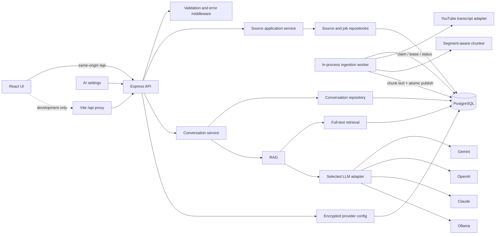

# VidScribe Project Guide

Living overview of the repository as it exists on 2026-10-30. “Current” describes implemented behavior; “later” describes product direction. Update this guide whenever a code change alters the system boundary or data flow.

## Product overview

VidScribe is a local-first workspace for asking questions about long-form learning content. In this release, a user adds a public YouTube URL. VidScribe retrieves English captions, chunks the transcript with timestamps, builds a PostgreSQL full-text index on the local machine, and answers questions with citations linking back to the video. The user can choose Gemini, OpenAI, Claude, or optional local Ollama for answer generation; Gemini is the default. Transcript indexing and retrieval do not require a cloud embedding API or an installed local model. PostgreSQL full-text search favors lexical matches over semantic similarity, which is a deliberate privacy/runtime trade-off.

The product term is **source**. YouTube is the first source adapter, not the core domain. The intended first release is a single-user research workspace; authentication, shared workspaces, additional input adapters, and multiple named conversations per source are future work. The first persisted conversation per source is implemented. See [the product boundary](product/product-boundary.md).

### Current capabilities

- Source library and source workspace with empty, queued, processing, ready, failed, retry, and citation states.
- Durable source and ingestion-job records, explicit API operations, and worker lease recovery.
- English YouTube transcript ingestion, segment-aware chunking with overlap, local PostgreSQL full-text indexing, and timestamp citations.
- Source-scoped lexical search and RAG answers through the selected Gemini, OpenAI, Claude, or optional Ollama adapter.
- AI provider settings with one provider selector, test-before-save flow, encrypted local API-key storage, Gemini as the default, and provider/model provenance on saved answers.
- Light/dark appearance settings with a header toggle and browser-local persistence.
- One persisted conversation per source, including user turns, answer status, citations, safe failures, and retry state.
- PostgreSQL migrations that rename the former video tables in place and preserve their rows.
- API health reporting, structured contextual logs, retryable error responses, and graceful process shutdown.

Conversation and message records are durable in PostgreSQL. Reopening a ready source restores the same history; pending generations are polled and can be resumed after their lease expires. There is no user identity, workspace ownership, multi-source retrieval, transcript editor, named conversations, or hosted deployment contract yet.

## Architecture



The frontend uses relative `/api` paths. During development, Vite proxies that prefix to the backend using the shared repository `.env`; the proxy target is read by Vite configuration and is not bundled into browser code. The backend API and one worker loop run in the same Node.js process today. The HTTP server binds to loopback and does not enable cross-origin browser access for the current local-only boundary. PostgreSQL is the durable work queue, so another backend process can compete for jobs, although independently scaling worker processes is deferred.

### Request flow: add a source

1. `POST /api/sources` validates a URL and extracts the canonical YouTube video ID.
2. In one database transaction, the source row is inserted using `(source_type, external_id)` as its idempotency key and a queued `ingestion_jobs` row is created.
3. Duplicate submissions return the existing source and current state instead of creating another source.
4. The API returns promptly. A worker claims queued work with `FOR UPDATE SKIP LOCKED`, sets a random lease token and expiry, then reports persisted phases.
5. The worker fetches captions and chunks the transcript, then replaces searchable chunks and marks the source ready in one fenced transaction. PostgreSQL maintains its GIN full-text index as those rows are written.
6. The UI polls persisted source state. A refresh or navigation does not lose processing state.

### Request flow: ask a question

1. `POST /api/sources/:sourceId/chat` validates the question and client turn UUID and checks that the source is `READY`.
2. Request middleware generates a fresh server-side request ID and returns it in `X-Request-Id`. The validated source ID and stable turn ID are carried with it as safe log context; request bodies and provider prompts are not logged.
3. A short transaction locks the source conversation, checks the idempotency key, and commits the user message plus a leased pending assistant message.
4. The retrieval repository tokenizes the question with PostgreSQL English text search, matches the selected source's indexed chunks, and ranks hits with `ts_rank_cd`. Retrieval duration, result count, and chunk IDs are logged with request and turn IDs.
5. The RAG service passes only the question and matched transcript passages to the selected provider adapter. Search remains local; answer inference can use Gemini, OpenAI, Claude, or optional Ollama. No database transaction stays open during inference. Provider duration and normalized usage are logged with the same correlation context.
6. A fenced transaction stores the answer, citations, and provider/model provenance, or a safe failure state. Replaying a completed turn returns the stored result without another model call.
7. The response includes typed citation excerpts and timestamped YouTube links generated by VidScribe. The UI reads persisted history after navigation or refresh.

## Processing state model

```text
QUEUED -> PROCESSING -> READY
                  \-> FAILED -> (user retry) -> QUEUED
```

`PROCESSING` includes the persisted phase `FETCHING_TRANSCRIPT`, `CHUNKING`, `INDEXING`, or `PERSISTING`. Jobs have attempt counts, a maximum attempt count, availability time, lease owner/token/expiry, and a completed timestamp. A crashed worker leaves a lease that expires; a later worker can reclaim it. A random token fences off a stale worker if another worker has reclaimed the job. Transcript, database, or indexing failures become `FAILED`; the UI retries the same source explicitly when `processing_retryable` is true. Chat answer-provider failures are stored on that assistant turn and do not change the source's ready state. Automatic exponential retry is not implemented.

## Technologies and why they exist

| Technology                       | Role and reason                                                                                                                                                                                                                                                                                                                            |
| -------------------------------- | ------------------------------------------------------------------------------------------------------------------------------------------------------------------------------------------------------------------------------------------------------------------------------------------------------------------------------------------ |
| Node.js + TypeScript             | Runs the API and worker; typed contracts clarify source states and API boundaries.                                                                                                                                                                                                                                                         |
| Express 5                        | HTTP routing, validation middleware, controllers, and centralized error serialization.                                                                                                                                                                                                                                                     |
| React + Vite                     | Library/workspace UI and fast local development. Vite provides a same-origin API proxy only in development.                                                                                                                                                                                                                                |
| PostgreSQL (`pg`)                | Stores sources, durable ingestion jobs, chunks, conversations, messages, and migration history. A GIN expression index over English `to_tsvector` supports local retrieval; row locks provide cross-process coordination. The driver converts `BIGINT` IDs only when they fit JavaScript's safe integer range to avoid silent ID rounding. |
| pgvector                         | A legacy vector column and the `vector` extension remain in the schema so existing stored vectors are preserved. Current ingestion writes no vectors and current retrieval does not use pgvector. Revisit removing this compatibility data only with an explicit migration/backup plan.                                                    |
| Ollama                           | Optional local runtime only if the user selects Ollama for answer generation. It is not required for indexing, retrieval, or Gemini answers.                                                                                                                                                                                               |
| Gemini, OpenAI, Anthropic Claude | Optional answer-generation APIs selected by the user. Each has a fixed provider adapter, configurable model ID, timeout, sanitized errors, and credentials encrypted by the backend. Gemini is the default active provider.                                                                                                                |
| PostgreSQL full-text search      | Normalizes English words, matches transcript terms locally, and ranks passages. It does not understand semantic similarity or synonyms without matching words.                                                                                                                                                                             |
| RAG                              | Retrieves transcript evidence before answer generation so answers can be grounded and linked to cited moments.                                                                                                                                                                                                                             |
| `youtube-transcript`             | First source adapter; returns English transcript segments and timestamps. It is an external dependency and may fail independently.                                                                                                                                                                                                         |
| Docker Compose                   | Starts the local PostgreSQL/pgvector service. The API, frontend, and Ollama are not containerized by the current Compose file.                                                                                                                                                                                                             |
| RabbitMQ                         | Not introduced. PostgreSQL is enough for the current single-host job volume and keeps source/job writes atomic. Add a broker only when measured throughput, independent worker scaling, or broker-specific delivery needs justify another operational system.                                                                              |

## Data model

- `sources`: source type and external identity, canonical URL, optional title, processing status/phase, safe failure fields, and timestamps. Unique `(source_type, external_id)` makes duplicate submission idempotent.
- `ingestion_jobs`: one durable job per source; queue status, claim attempts, retry count, maximum attempts, availability time, lease token/owner/expiry, current phase, and completion time.
- `source_chunks`: ordered transcript content, nullable timestamp bounds, a nullable legacy pgvector embedding, and an English full-text expression index on `content`. New full-text-only rows have a `NULL` embedding. A unique `(source_id, chunk_index)` prevents duplicate chunk positions; deleting a source cascades to its job and chunks.
- `conversations`: one conversation per source in V1. The unique source relation leaves room for a future conversation collection without implying the current UI supports it.
- `messages`: ordered user and assistant rows. A shared UUID `turn_id` and unique `(conversation_id, turn_id, role)` prevent duplicate rows for a retried request. Assistant rows track pending/completed/failed status, citations, safe failure fields, attempt count, generation lease token/expiry, and nullable provider/model provenance for generated answers.
- `ai_provider_configs`: one provider-specific model and optional encrypted credential per named provider. The API returns only a configured flag, never the stored ciphertext.
- `ai_runtime_settings`: one global selected answer provider for the current single-user boundary, seeded to Gemini.
- `schema_migrations`: applied migration version and checksum. Migrations are explicit and checksum-checked.

Migration `001_source_processing.sql` renames legacy `videos` and `video_chunks` tables and their key columns in place, normalizes old statuses, and seeds jobs. Migration `002_source_conversations.sql` creates one conversation for every existing source and adds constrained message storage. Migration `003_ai_provider_settings.sql` seeds Gemini as the default active answer provider, adds encrypted provider configuration storage, and records provider/model provenance on assistant messages. Migration `004_postgres_full_text_search.sql` makes the legacy embedding column nullable, adds a GIN index for English transcript search, and renames the old processing phase `EMBEDDING` to `INDEXING`. Apply migrations explicitly with `npm run db:migrate` from `backend/`; back up a database before schema changes.

## API surface

| Method and path                           | Behavior                                                                                                                                                 |
| ----------------------------------------- | -------------------------------------------------------------------------------------------------------------------------------------------------------- |
| `GET /api/health`                         | Reports PostgreSQL and whether the selected answer provider is configured. It does not make billable provider probes.                                    |
| `GET /api/settings/ai`                    | Reads active provider/model configuration without returning secrets.                                                                                     |
| `POST /api/settings/ai/test-and-save`     | Sends a short generation prompt to the chosen provider; on success, atomically saves its model/key and activates it.                                     |
| `POST /api/sources`                       | Idempotently create or retrieve a source and queue its job.                                                                                              |
| `GET /api/sources`                        | List library sources, newest update first.                                                                                                               |
| `GET /api/sources/:sourceId`              | Read the persisted state of one source.                                                                                                                  |
| `GET /api/sources/:sourceId/conversation` | Load the source's persisted messages and current answer states.                                                                                          |
| `POST /api/sources/:sourceId/retry`       | Requeue a failed, retryable source; repeated requests converge on current work.                                                                          |
| `DELETE /api/sources/:sourceId`           | Delete a source and cascade its job/index.                                                                                                               |
| `POST /api/sources/:sourceId/chat`        | Submit `{ question, requestId }`; returns a completed result (200) or current pending turn (202). Reusing the UUID with the same question is idempotent. |

HTTP adapters live in controllers/routes; source workflow decisions live in application services; SQL lives in repositories. Services do not format HTTP responses. See [the source API guide](services/source-library-api.md).

## Project structure and dependency direction

```text
package.json                    Root npm workspace scripts and dependency coordination
scripts/dev.mjs                 Cross-platform launcher for backend and frontend dev processes
backend/
  package.json                  Backend workspace scripts and dependencies
  migrations/                  Ordered SQL schema changes
  src/
    app.ts                      Express composition root
    server.ts                   HTTP, worker startup, graceful shutdown
    controllers/                HTTP request/response adapters
    routes/                     API route registration
    validators/                 Request contract validation
    middleware/                 Request correlation, validation, and error serialization
    services/                    Use cases and domain workflows
      sources/                   Library and source lifecycle
      chat/                       Conversation persistence and answer-turn orchestration
      ingestion/                 Worker orchestration and chunking
      youtube/                   YouTube identity/transcript adapter
      rag/, llm/                  RAG coordination, citations, provider registry and answer generation
        providers/                Gemini, OpenAI, and Anthropic request adapters
      ai-settings.service.ts     Provider configuration and active-provider use case
      health/                    Dependency health probes
    repositories/               PostgreSQL queries and transactional writes, including AI settings
    db/                          Pool, transaction helper, migration runner
    shared/                      Configuration, errors, logger, optional Ollama client, local secret encryption
    types/                       Cross-module data contracts
  test/                          Node test-runner unit tests
frontend/src/
  package.json                  Frontend workspace scripts and dependencies
  App.tsx                         Navigation and page composition
  components/                    Library, source workspace, chat, provider settings, and appearance UI
  services/api.ts                Typed same-origin API client
  types/types.ts                 Browser-facing DTOs
  App.css, index.css             Product layout and visual system
  styles/design-tokens.css       Semantic light/dark palette and reusable type/space/shape/elevation scales
  vite.config.ts                 Development proxy and shared env loading
docs/                             Product, architecture, service, decision, interview docs
```

The root npm workspace coordinates installs and developer commands while backend and frontend remain separate packages with independent build and runtime boundaries. Run `npm install`, `npm run dev`, `npm run build`, `npm test`, and `npm run db:migrate` from the repository root. The root `dev` command launches the backend TypeScript watcher and Vite directly as sibling Node processes; Ctrl+C stops both, and an unexpected exit stops the other process. Dependency direction inside the backend: routes/controllers call application services; services coordinate repositories and narrow external adapters; repositories own SQL and accept a transaction client when atomicity spans multiple statements. Shared code is for cross-cutting primitives, not business workflows. Keep provider details out of controllers and keep SQL out of services.

## Reliability boundaries and known limits

- **Duplicate submissions:** unique source identity and transactional source/job creation converge concurrent submissions on one source. The API has no separate client idempotency-key header because this source identity is naturally stable.
- **Worker concurrency:** `SKIP LOCKED` distributes rows among workers; expiring leases recover process crashes; lease tokens fence stale results. A stale worker may waste a transcript request or chunking CPU after lease loss, but cannot publish stale chunks.
- **Atomic publication:** old chunks are replaced and `READY` is committed with all new chunks in one transaction. PostgreSQL updates the GIN search index as part of the same transaction; rollback leaves the previous chunk set and index visible.
- **Retry policy:** the UI requests retry of the same source. There is no automatic backoff, dead-letter queue, or per-provider retry budget. Repeated worker crashes are bounded by `max_attempts`.
- **External calls:** the transcript library does not expose an abort signal in this adapter, so shutdown can wait for an active transcript call to return. Gemini/other answer calls have a timeout. A future transcript timeout/cancellation contract is needed before long-running hosted workers.
- **Chat retries:** a UUID turn ID makes a repeated request for the same question return its stored result or claim an expired/failed answer. A live generation lease returns pending; its token fences stale completion. If inference succeeds but the database commit fails, the turn stays pending until its lease expires and may be generated again. That is at-least-once model work with idempotent durable publication, not exactly-once inference.
- **Chat generation:** the HTTP request still waits for synchronous RAG inference. Messages are committed before inference so reloads can see the pending turn, but there is no independent chat worker, push channel, or automatic recovery scheduler. The client resumes an expired turn; a later phase can move answer generation to a durable worker if long waits or abandoned-browser recovery require it.
- **Provider selection:** Gemini is the seeded default, but requires a user-supplied key before generation. There is no silent fallback; users must select a configured provider themselves. OpenAI, Claude, and Ollama are available answer adapters. Model IDs can be edited and must be valid for the chosen provider/account.
- **Provider test/save:** the explicit test endpoint sends a short generation prompt before writing changes. A failed test leaves prior settings intact; a successful test saves provider config and active selection in one short transaction. The provider call happens outside the transaction and may be billable. Concurrent settings edits from multiple tabs remain last-writer-wins.
- **Credential handling:** cloud keys are encrypted with AES-256-GCM before storage in PostgreSQL, and settings responses never include the key or ciphertext. The encryption key lives in the user's OS application-config directory, outside this repository (`%LOCALAPPDATA%\\VidScribe` on Windows; XDG/macOS application config paths elsewhere). Back up that key with the database if preserving saved credentials matters; if it is lost, enter provider keys again. This protects against a database-only disclosure, not compromise of the same user account/computer. The API binds to loopback today and has no remote user authentication boundary.
- **Cloud data flow:** transcript indexing and search stay in PostgreSQL. When a cloud answer model is selected, only the user's question and matched source excerpts are sent to that provider and may incur charges on the user's account. Provider APIs are non-streaming with a fixed request timeout and sanitized error handling.
- **Provider extensibility:** adapters are registered behind a small provider-neutral interface. Only vetted named adapters are accepted. Arbitrary user-defined API base URLs are deferred because they would introduce server-side request forgery (SSRF) and endpoint-validation concerns.
- **Appearance:** light/dark choice is stored in browser local storage and applied through a root theme attribute. It is a local preference, not an account setting, so it does not synchronize across browsers or users.
- **Search scale/quality:** PostgreSQL GIN full-text search is indexed locally, but retrieval is lexical and English-only. Measure query plans, corpus size, and retrieval quality before adding another search backend or a hybrid vector strategy.
- **Auth and ownership:** single-user local-first operation is the current boundary. Add identity/authorization before serving multiple users or exposing stored content remotely.
- **Observability:** every HTTP request receives a fresh `X-Request-Id`; chat logs carry that ID plus the durable turn UUID and source ID through claim, retrieval, provider generation, persistence, and HTTP completion. Logs include stage durations and provider-reported token counts when available, but no question, transcript, prompt, credential, or query string. Usage is not persisted or priced; logs are not durable metrics, distributed traces, or alerting.
- **Retrieval evaluation:** an isolated PostgreSQL fixture checks four labeled lexical queries at `k=3`, citation timestamp/URL mapping, source scoping, and no-searchable-term behavior. Its synthetic baseline deliberately includes one paraphrase miss. It is a regression set for SQL/search semantics, not a measure of real-video answer quality or LLM factuality.

## Local development

1. Copy `.env.example` to `.env` and set the local PostgreSQL password and model names.
2. From the repository root, run `npm install` to install backend and frontend workspace dependencies.
3. Start PostgreSQL with `docker compose up -d postgres` from the repository root.
4. Run `npm run db:migrate` from the repository root, then `npm run dev` to start the API and UI together.
5. No local AI runtime is required for indexing or search. Install and configure Ollama only if you want to select it as the answer provider. Vite reads `FRONTEND_PORT` and `BACKEND_PORT` from the repository-root `.env` and proxies `/api` to the backend.
6. Open **Settings → AI model** to choose a provider, enter a cloud API key if needed, then test and save it. Keys are not placed in `.env` or returned to the browser. Gemini is selected by default until another provider passes its test-and-save flow.

For PostgreSQL integration tests, use the separate [test Compose file](../docker-compose.test.yml), which publishes its dedicated `vidscribe_test` database on an automatically assigned localhost port and uses a test-only volume. The root README documents the exact run and reset commands; do not point the integration suite at the normal development database.

The migrations intentionally change legacy table names/status values while retaining rows, then add source conversations and messages. Review the SQL and keep a database backup before applying them to an existing database. Do not edit an applied migration; add a new numbered migration.

## Verification

- Backend compile: `cd backend && npm run build`
- Backend unit tests: `cd backend && npm test`
- Frontend compile/build: `cd frontend && npm run build`

Unit tests cover URL parsing, request validation, chunk overlap/timestamps, provider request formats, and API-key encryption. The full backend suite passed against the isolated PostgreSQL test database on 2026-10-29 (13 passed, 0 failed, 0 skipped); migrations `001`–`003` were applied there. PostgreSQL scenarios cover concurrent source/job creation, competing claims, idempotent retry, expired-lease reclaim, stale-token fencing, rollback after a duplicate chunk insert, concurrent duplicate chat turns, answer replay, citation and provider/model provenance persistence, provider selection, retry eligibility, stale chat fencing, source-to-conversation cascade deletion, and completion racing source deletion. A browser smoke check confirmed the Gemini default, provider cards, key-entry fields, configuration warning, and selectable Ollama answer provider. No cloud credentials were configured, so no billable provider request was made. Backend and frontend builds passed. Real provider account/model calls remain an environment-level verification step.

Historical verification for the PostgreSQL retrieval migration: backend and frontend builds passed; the isolated PostgreSQL suite passed 13/13 tests after migrations `001`–`004`. The integration case verified full-text matching/ranking, stopword-only no-match, source scoping, nullable legacy vectors, and atomic chunk publication. At that point the real provider check remained outstanding; the user later reported successfully testing provider-backed answers.

The user has manually verified answer generation with configured providers. Exact provider/model, latency, and usage observations have not been archived, so this confirms the integration path but does not establish an operating baseline.

Latest implementation verification on 2026-10-30: root `npm run build` and `npm run lint` passed. The backend suite passed 14/14 with the dedicated `vidscribe_test` PostgreSQL container and migrations `001`–`004`. The new fixture met `Recall@3 = 0.75`, verified timestamp/source citation mapping, and preserved one expected lexical paraphrase miss. The request-context test verified unique server-generated IDs, the response header, normalized route logging, and exclusion of query-string secrets. These automated tests did not call an AI provider.

## Documentation map

- [Product boundary](product/product-boundary.md)
- [Library and source workspace UX](product/library-and-source-workspace.md)
- [AI provider settings UX](product/ai-provider-settings.md)
- [AI provider settings service](services/ai-provider-settings-service.md)
- [System overview](architecture/system-overview.md)
- [Evolution log](architecture/evolution.md)
- [Source library API and service](services/source-library-api.md)
- [Persisted chat conversation service](services/chat-conversation-service.md)
- [Request context middleware](services/request-context.md)
- [Ingestion service](services/ingestion-service.md)
- [Chunking](services/chunking-service.md), [YouTube adapter](services/youtube-source.md), [PostgreSQL full-text search](services/postgres-full-text-search.md), [retrieval and RAG](services/retrieval-rag-service.md), [optional Ollama answers](services/ollama-service.md), [LLM provider settings and generation](services/llm-provider-service.md)
- [Durable job and lease decision](decisions/postgres-backed-ingestion-jobs.md)
- [Chunk overlap decision](decisions/chunk-overlap.md)
- [Transaction boundary decisions](decisions/embedding-before-transaction.md), [atomic publication](decisions/transactional-chunk-persistence.md)
- [Persisted conversations and idempotent turns](decisions/persisted-conversations-and-idempotent-turns.md)
- [Multi-provider generation and encrypted key storage](decisions/multi-provider-generation-and-key-storage.md)
- [Test provider configuration before activation](decisions/provider-test-before-save.md)
- [Semantic design tokens](decisions/semantic-design-tokens.md)
- [Provider usage telemetry without a billing ledger](decisions/provider-usage-telemetry.md)
- [Local PostgreSQL full-text retrieval](decisions/local-postgres-full-text-retrieval.md)
- [Chat observability and retrieval evaluation](decisions/chat-observability-and-retrieval-evaluation.md)
- [Interview reference](interview/engineering-concepts.md)
