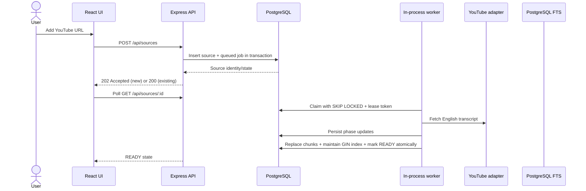

# System Overview

This document describes the system that is implemented today. Product goals and deferred capabilities are separated from current behavior.

## Components

| Component | Responsibility |
| --- | --- |
| React application | Library navigation, source lifecycle states, retry/removal, question composer, answer and citation display. |
| Express API | Validates requests, serializes DTOs, exposes source lifecycle and conversation endpoints, and reports dependency health. |
| AI settings service/repository | Tests provider credentials/models, stores the selected answer provider/model and encrypted credentials, and returns only safe status/configuration fields to the UI. |
| Source service/repository | Canonicalizes YouTube identity, creates or returns the source/job atomically, and reads or mutates library state. |
| Conversation service/repository | Persists one conversation per source, claims idempotent answer turns, tracks pending/failure state, and stores answer citations using fenced writes. |
| PostgreSQL worker loop | Claims queued or expired jobs with row locking, tracks phases and lease ownership, and triggers ingestion. It runs in each backend process. |
| YouTube adapter | Parses supported YouTube URLs and fetches English transcript segments. |
| Ingestion service | Coordinates caption retrieval, chunking, lease checks, and atomic local full-text index publication. |
| Full-text retrieval repository | Uses a PostgreSQL GIN expression index and source-scoped rank query to find transcript passages locally. |
| LLM provider registry/adapters | Dispatches answer generation to the selected Gemini, OpenAI, Anthropic Claude, or Ollama adapter. Cloud keys are decrypted only in the backend process immediately before a request. |
| Local secret store | Creates/loads the per-user AES-256-GCM key outside the repository and encrypts cloud credentials before database persistence. |
| Citation service | Maps matched transcript chunks to source/timestamp citations. |
| PostgreSQL | Durable source/job state, transcript chunks, GIN full-text index, conversations, messages, and migration history. The legacy pgvector column/extension remain to preserve old stored data, but current retrieval does not use them. |

## Data flow



Question submission remains synchronous through RAG, but its state is durable. The API commits a user message and pending assistant message under a per-source conversation lock, then runs local PostgreSQL retrieval and chat inference outside a database transaction. A fenced completion transaction stores the answer and citations. The UI restores messages from `GET /conversation`, polls pending answers, and can safely resubmit an expired turn with the same UUID.

Provider configuration follows a separate flow: the backend makes a short generation request with the proposed model/key; only after it succeeds does a short transaction save the encrypted credential/model and activate that provider. Light/dark appearance is stored locally by the browser and does not call the API.

```mermaid
sequenceDiagram
  actor User
  participant UI as React UI
  participant API as Express API
  participant Conversation as Conversation service
  participant DB as PostgreSQL
  participant RAG
  participant Search as PostgreSQL FTS
  participant Registry as LLM provider registry
  participant Provider as Selected provider

  User->>UI: Submit question + client turn UUID
  UI->>API: POST /sources/:id/chat
  API->>Conversation: Validate source readiness and claim turn
  Conversation->>DB: Lock conversation; insert user + PENDING assistant
  DB-->>Conversation: Commit IDs + generation lease
  Conversation->>RAG: Generate answer outside transaction
  RAG->>Search: Search source-scoped transcript chunks
  Search->>DB: Rank local text matches
  RAG->>Registry: Generate answer from retrieved excerpts
  Registry->>Provider: Provider-specific request (Gemini/OpenAI/Claude/Ollama)
  Provider-->>Registry: Answer text + optional usage
  Registry-->>RAG: Answer text + provider/model
  RAG-->>Conversation: Answer + citations + provenance
  Conversation->>DB: Fenced PENDING -> COMPLETED update
  API-->>UI: 200 answer, or 202 if another request owns the lease
  UI->>API: GET /sources/:id/conversation while pending
  API->>DB: Read ordered persisted messages
```

## State and consistency rules

- A source is created with its job in one transaction. A successful source insert cannot commit without its queued job.
- Only a job with an eligible queue status and expired/unset availability is claimable. `FOR UPDATE SKIP LOCKED` makes concurrent workers take different jobs.
- Each claim receives a random lease token. Heartbeats renew expiry. Completion/failure writes require the current token and processing state.
- The source is `READY` only when all new chunk rows, their GIN index entries, and the completed job commit together.
- A retry reuses the same source and job rows. It resets the current attempt counter, increments retry count, and clears stale failure/lease data.
- Deletion locks the job before deleting the source, matching the lock order used by claim, retry, and completion.
- Each source has one conversation. `turn_id` is unique per message role; a transaction locks the conversation while deciding whether the request is new, in progress, completed, or retryable.
- User message and pending assistant message commit before inference. Answer completion/failure uses the current generation token, and citations persist with the answer.
- A crash can leave a pending answer. The generation lease expires; a later client retry can claim the same message pair. If the earlier inference is still running, its stale token cannot publish after the new claim.

## Runtime and external dependencies

The backend process starts the HTTP server on loopback and one polling worker loop. The API does not enable broad CORS; the browser uses the Vite same-origin proxy in development. PostgreSQL is required for every lifecycle operation. YouTube captions are needed for ingestion. Ollama is optional and used only when selected for answer generation. Gemini/OpenAI/Claude answers need a configured API key; cloud providers are not health-probed to avoid making billable calls. A polling error is logged and retried on the next worker interval. Migrations run as an explicit command rather than silently changing a database on server startup.

Vite proxies `/api` during development. Production serving/reverse proxying is not yet packaged. Docker Compose starts PostgreSQL with pgvector only. RabbitMQ, a separate worker deployment, user identity, and multi-tenant isolation are deferred until there is a measured product need.

## Failure and recovery

- API request rejected by validation: no source or job is written.
- Duplicate URL: the unique `(source_type, external_id)` index returns the existing source and job state.
- Worker crash: the job remains `PROCESSING` until its lease expires, then another worker may reclaim it. Repeated unclean claims are bounded by `max_attempts`.
- YouTube transcript failure: source and job move to `FAILED`; safe error fields are shown to the user. Retry is offered only when marked retryable.
- Failure before final transaction: no new chunks are visible.
- Failure in the final transaction: chunk replacement and `READY` roll back together.
- Source deletion racing a worker: job-row lock ordering and the lease-token check prevent deleted or stale work from publishing.
- Lost commit acknowledgement: a second failure update is fenced by job status/token; if the final commit succeeded, it cannot turn the completed source back into failed.
- Question request lost after commit: the client repeats the same UUID; the repository returns the current pending/completed turn instead of creating another pair.
- PostgreSQL retrieval failure or selected answer-provider failure: the assistant row stores a safe failure code/message and retryability; the user question remains in history. Credentials and raw upstream response bodies are not returned or logged.
- Active cloud provider is unconfigured or its encryption key is unavailable: generation fails with a safe configuration error; VidScribe never silently sends the prompt to another provider.
- Cloud provider returns an authentication, rate-limit, timeout, or service error: the request is bounded by the provider timeout, mapped to a stable sanitized error, and can be retried explicitly when eligible. The UI identifies the selected provider/model on completed answers.
- Process crash during answer generation: the row stays pending until lease expiry. A user can resume it on return; there is no separate answer worker yet.
- Answer commit failure after successful inference: the turn may be generated again after lease expiry; durable completion remains single-writer and idempotent, while model execution is at-least-once.

See [the job decision](../decisions/postgres-backed-ingestion-jobs.md), [persisted chat decision](../decisions/persisted-conversations-and-idempotent-turns.md), [provider/key decision](../decisions/multi-provider-generation-and-key-storage.md), [chat service guide](../services/chat-conversation-service.md), and [LLM provider service guide](../services/llm-provider-service.md) for concrete scenarios and trade-offs.

See the [local PostgreSQL full-text retrieval decision](../decisions/local-postgres-full-text-retrieval.md) for the privacy/quality trade-off and the [usage telemetry decision](../decisions/provider-usage-telemetry.md) for provider measurement limits.
