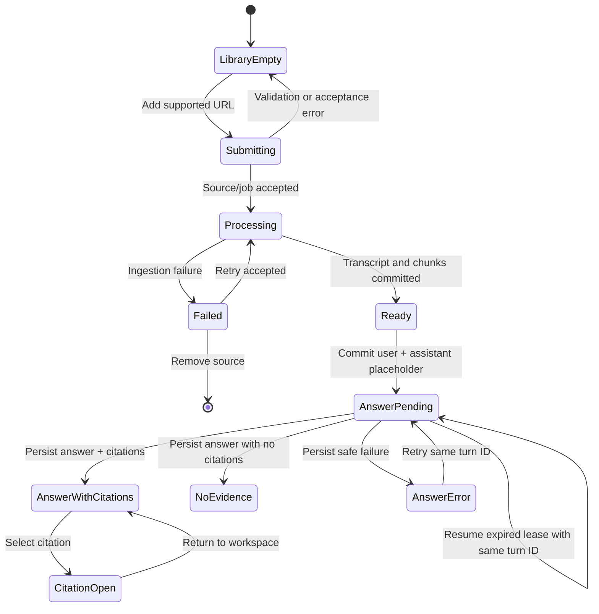

# Library and Source Workspace UX Map

**Status:** UX specification with the source lifecycle screens implemented on 2026-10-29.  
**Depends on:** [Product boundary](product-boundary.md)

This document is both the UX contract and a record of the current UI. The matrix below calls out implemented behavior and deliberate gaps so the specification does not imply capabilities the application does not yet have.

## Implementation status

| State/flow | Current behavior |
| --- | --- |
| Empty and populated library | Implemented with a responsive navigation sidebar, empty state, source list, and add-source dialog. |
| Queued and processing | Implemented with persisted phase polling. Progress is indeterminate; the UI does not invent a percentage. |
| Ready | Implemented with source details, source-scoped Q&A, and answer citations linking to YouTube timestamps. |
| Failed and retry | Implemented. Retry appears only when `failure.retryable` is true and reuses the same source/job. |
| Remove source | Implemented with confirmation; job/chunks are deleted through database cascades. |
| Conversation history | Implemented as one persisted conversation per source. Reopening a ready source restores user/assistant messages, answer status, citations, and retry state. |
| Video preview | Current UI uses a product preview card and external YouTube link; it does not embed a player or seek citations in-app. |
| Polling optimization | The workspace polls persisted state while queued/processing. Visibility-aware backoff is deferred. |

The implemented screen components are `frontend/src/components/LibraryPage.tsx`, `AddSourceDialog.tsx`, and `SourceWorkspace.tsx`; API behavior is documented in [the source API guide](../services/source-library-api.md).

## Information architecture

V1 has two primary locations:

- **Library** at `/library` (also the default route): the user's saved sources and their processing states.
- **Source workspace** at `/sources/:sourceId`: one selected source, its readiness/details, and its persisted conversation.

Use “source” in navigation and user-facing copy. A source is a supported YouTube video in V1. The current UI restores one persisted conversation per source; named conversations and a separate conversation history browser are deferred.

## Shared application shell

### Desktop layout

```text
┌──────────────────────────────────────────────────────────────────────────┐
│ VidScribe                         Dependency/status message (when needed) │
├──────────────────────┬───────────────────────────────────────────────────┤
│ Library              │ Current page                                      │
│ [+ Add source]       │                                                   │
│                      │                                                   │
│ Source list          │                                                   │
│ • Source A · Ready   │                                                   │
│ • Source B · Working │                                                   │
│ • Source C · Failed  │                                                   │
└──────────────────────┴───────────────────────────────────────────────────┘
```

The source list is the durable navigation surface, not chat history. Each row shows a source title or safe fallback label, a source-type marker, and a text status badge. Failed rows expose a retry action only when the server says retry is allowed. The sidebar remains usable while another source is processing.

### Narrow screens

Collapse the library into a drawer opened from the page header. Keep the selected source title and state visible. Stack the source preview and conversation vertically; keep the message composer reachable without horizontal scrolling. Do not hide processing or error text in hover-only controls.

### Global dependency states

- **Database unavailable:** keep a visible dependency banner and show the library/conversation load error with retry. Keep already loaded messages visible while the refresh fails.
- **Database unavailable:** keep cached library state usable where possible. Explain that local indexing, search, and persisted conversations need PostgreSQL, then provide a recheck action.
- Avoid showing raw stack traces, SQL messages, hostnames, or provider response bodies in the UI.

## Screen 1 — Empty library

### Layout and content

- Sidebar shows the VidScribe mark, `Library`, an `Add source` action, and an empty list message.
- Main area has one clear headline, a short explanation that answers include timestamped video sources, a YouTube URL field, and a primary `Add video` button.
- Explain the current constraint near the form: public YouTube video with English captions. A help link can explain transcript limitations.
- Show an inline validation message for malformed or unsupported URLs. Do not use a browser alert.

### Actions

- Submit a URL. On acceptance, create one library item and navigate to that source's processing view.
- If the source already exists, open its current state instead of creating a duplicate.
- If submission fails before a source is accepted, keep the URL in the field and show a retryable or corrective message.

### Empty-state acceptance

The user can tell what the product does, what inputs are supported, how to begin, and what will happen after submission without needing the developer notes.

## Screen 2 — Populated library

### Layout and content

- The page title is `Your library`, with a persistent `Add source` action.
- List sources by most recently added/updated. Each item shows a title when known; otherwise show `YouTube video · {video ID}` plus a shortened URL.
- Show statuses as text and icon together: `Queued`, `Processing`, `Ready`, or `Failed`.
- Ready items open their source workspace. Processing items open the progress view. Failed items open the failure detail and available recovery action.
- Keep source actions (open, retry when eligible, remove) in an accessible menu. Removal requires confirmation and names the source being removed.

### No-results state

If a later library filter produces no matches, distinguish “No matching sources” from a truly empty library and provide a clear reset action. Full-text or cross-source search is outside V1.

## Screen 3 — Queued and processing source

The source workspace opens as soon as the API accepts an ingestion job; the request should not wait for transcript retrieval or indexing to finish.

### Layout and content

- Header shows the source title/fallback, `YouTube`, a status badge, `Open on YouTube`, and source actions.
- Main content shows an indeterminate progress treatment and a plain-language current phase, such as `Waiting to start`, `Getting captions`, `Preparing transcript`, `Indexing content`, or `Saving source`.
- Explain that processing can take a while and that the user can leave this page; the source will remain in the library.
- Disable the chat composer and explain why until indexing completes. Do not present an empty chat as if the source were ready.
- Do not show a made-up percentage. Transcript retrieval and indexing do not provide a reliable total-work denominator.

### State refresh

For V1, use status polling with a bounded interval/backoff and stop or slow polling when the page is hidden. A server-pushed event channel can be considered later if polling becomes wasteful. Returning to the page always fetches current persisted state first; browser memory is not the source of truth.

### Processing acceptance

Submitting a source returns promptly with an accepted source/job identity. Progress survives navigation and refresh. The library row and workspace header agree on status. A ready state is shown only after usable chunks and their local full-text index are committed.

## Screen 4 — Ready source workspace

### Desktop composition

```text
┌──────────────────────┬───────────────────────────────────────────────────┐
│ Library sidebar      │ Source title · Ready       Open on YouTube · Menu │
│                      ├────────────────────────┬──────────────────────────┤
│ Selected source      │ Video preview /        │ Conversation              │
│                      │ transcript details     │                            │
│                      │                        │ Answer with sources        │
│                      │ Open video at timestamp│                            │
│                      ├────────────────────────┤                            │
│                      │ Source excerpt panel   │ Ask about this video...    │
└──────────────────────┴────────────────────────┴──────────────────────────┘
```

The source preview can be a YouTube embed when embedding is allowed. If the video disallows embedding, show a useful preview card and `Open on YouTube` link instead. The user must still be able to use timestamp citations in either case. Keep the conversation and composer as the main workspace; source details should support it rather than crowd it.

### New conversation state

- Show a concise prompt that questions are grounded in this video's transcript.
- Offer a few generic starter prompts (for example, “Summarize the main idea” or “What are the key steps?”); do not imply that these have already been answered.
- Current behavior: the workspace fetches one persisted conversation per source. An empty conversation shows starter prompts; a saved conversation restores user and assistant messages in order.
- Deliberate scope: multiple named conversations per source and a separate history navigator are not needed for the first release.

### Answer generation state

- Persist the user message and pending assistant placeholder before inference begins. The UI displays pending state from the stored row and polls while it remains pending.
- Use one honest pending label (`Finding relevant moments and writing an answer…`) because retrieval and generation phases are not separately exposed by the API.
- Disable another composer submission while this source has a pending answer. Keep the original turn ID for retry so concurrent tabs or lost responses cannot create duplicate messages.
- On a retryable failure, preserve the question and offer `Try this answer again`. On an expired pending lease, offer `Resume answer`; the same durable turn is reclaimed with a new fencing token.
- After navigation or refresh, read the persisted conversation instead of treating browser state as the source of truth. If storage is unavailable, keep any already loaded messages visible and show a refresh action.

## Screen 5 — Failed source

Failure content is based on a stable server error code and a `retryable` field, not string matching on an error message.

### Layout and copy

- Keep the source in the library with a `Failed` badge.
- In the workspace, identify the user-understandable stage and reason, then give the next action.
- Example permanent limitation: “English captions aren't available for this video. VidScribe currently needs captions to build searchable notes.” Do not offer a retry button that is expected to fail repeatedly.
- Example transient failure: “VidScribe couldn't retrieve or index this transcript. Check your connection and local database, then try again.” Offer retry when the backend marks the failure retryable.
- Provide `Open on YouTube`, `Remove source`, and a way back to the library.
- Keep technical diagnostic details in local logs; expose a safe error identifier for support/debugging if needed.

### Failure classes

| Class | Example | UI response |
| --- | --- | --- |
| User-correctable | Invalid URL, unsupported host | Inline form error; preserve entered URL. |
| Permanent for current V1 | No supported English captions, private/removed video | Explain the limitation; no automatic retry. Allow removal. |
| Transient/retryable | Temporary transcript-provider failure, database/index interruption | Explain the dependency/action; show retry only when safe. |
| Unknown | Unexpected internal error | Generic message plus stable error ID; never expose stack trace. |
| Answer generation | PostgreSQL retrieval or selected answer-provider failure after the user message is saved | Persist the assistant failure and retryability beside the original question; do not append a second user message when retrying. |

## Screen 6 — Retry

Retry is an action on the existing source, not a new source submission.

1. User selects `Retry processing` on an eligible failed source.
2. Button changes to a disabled `Retrying…` state immediately to prevent double clicks.
3. API returns the current or newly queued attempt for the same source identity.
4. The workspace returns to the queued/processing screen; the source does not appear twice in the library.
5. If the retry cannot be accepted, preserve the failed state and show an actionable error.

The job contract must distinguish retrying an existing attempt from creating a new source. The backend must enforce idempotency because a disabled button alone cannot protect against concurrent tabs or repeated HTTP requests.

## Screen 7 — Answer citations

Every answer with retrieved evidence has a `Sources` area immediately below that answer. Each citation card includes:

- A stable display number or short label within that answer.
- A start timestamp and, where useful, an end timestamp.
- A short transcript excerpt so the user can judge relevance before opening it.
- A link built by the application from the canonical YouTube video ID and timestamp, not a URL invented by the model.

Selecting a citation opens the YouTube video at the cited time in a new tab. If the embedded player is available and the final UI supports seeking, the same action may seek the in-app player instead. Keyboard users must be able to activate each citation and the link should communicate its destination to assistive technology.

The API should return a typed citation DTO, for example:

```ts
interface AnswerCitation {
  id: string;
  startSeconds: number;
  endSeconds: number | null;
  excerpt: string;
}

interface AnswerResult {
  answer: string;
  citations: AnswerCitation[];
}
```

Do not expose raw database rows or similarity scores as the UI contract. The server owns the source URL and constructs safe timestamp links from stored source identity.

### No-evidence answer

If no retrieved chunk meets the relevance policy, show a distinct assistant response explaining that the transcript did not contain enough evidence. Show no citation cards and do not imply that the model reviewed the full video. Keep the question in history and allow a follow-up question.

### Citation selection state

When the embedded player is available, selecting a citation seeks it to the start time and highlights that citation card while selected. If playback is blocked or unavailable, keep the citation link usable and show the external-open fallback. The citation remains attached to the answer even if playback fails.

## State and transition map



## Cross-state rules

- The source's persisted server status is authoritative; frontend state is a display cache.
- `Ready` means the source has a usable transcript/chunk set, not merely that a database row exists.
- Every state change has both a visible text label and a meaningful accessible announcement; color is supplementary.
- Preserve form input and user questions across recoverable failures.
- Keep retries explicit and bounded by server policy. Do not add blind frontend retry loops.
- Source removal must confirm the scope of deletion and only report success after the server confirms it.
- Show skeleton/loading affordances while fetching; show distinct empty, unavailable, and error states rather than rendering empty data for all three.

## Design review checklist

- Can a new user identify how to add a source and what kinds are supported?
- Can the user distinguish queued, actively processing, ready, and failed?
- Can they navigate away during ingestion and reliably return to current status?
- Does retry reuse the same source without duplicating it?
- Does every generated answer make its evidence easy to inspect?
- Can a citation still be used when the video cannot be embedded?
- Are permanent limitations distinguished from transient failures?
- Are loading, empty, error, and no-evidence states accessible and understandable?

## Next phase recommendation

Apply migrations on a disposable PostgreSQL instance, execute the expanded concurrency/retry integration tests, and verify page reload, answer resume, failure retry, and citations in the browser. After measuring local model latency, consider moving answer execution to a durable background worker if abandoned requests or long HTTP waits are a demonstrated problem.
